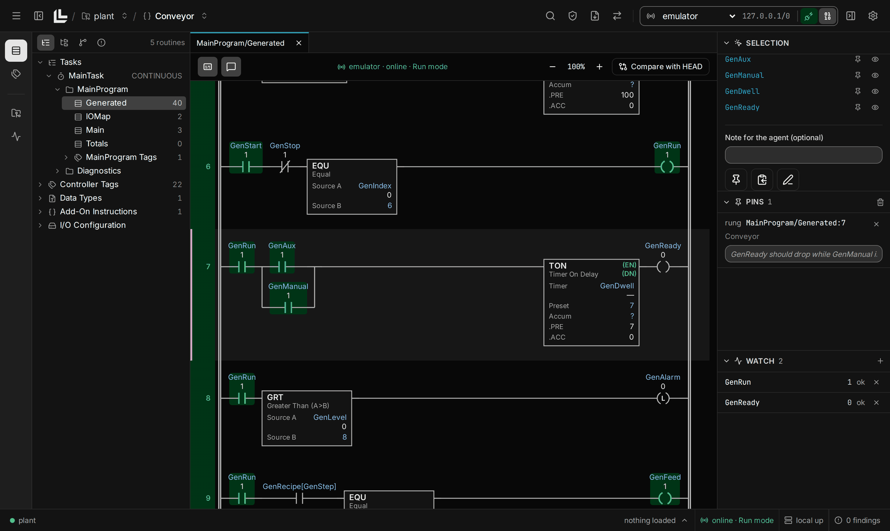
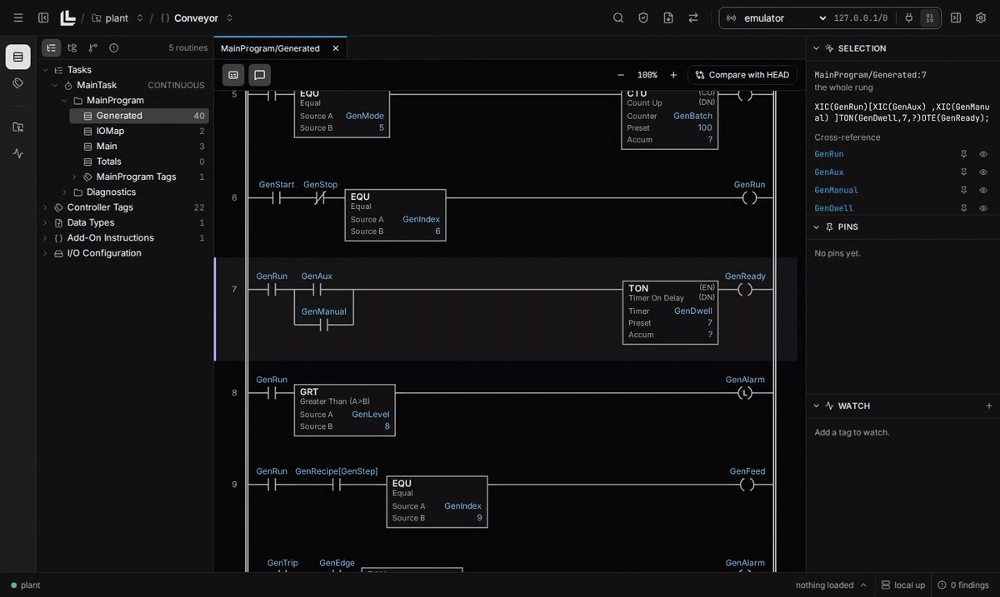
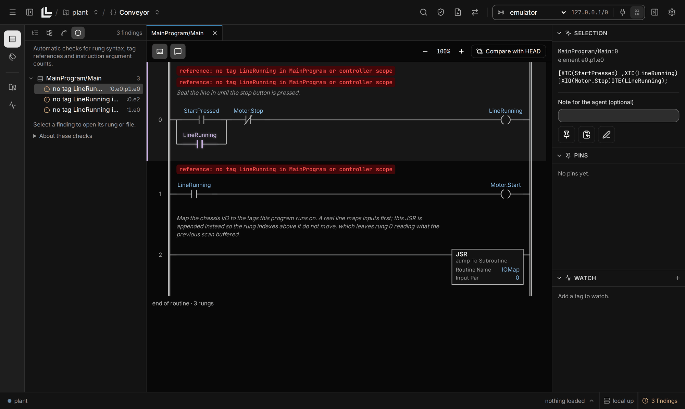

<p align="center">
  
</p>

<h1 align="center">Logicly</h1>

<p align="center">
  <strong>A workbench for AI-assisted PLC development.</strong><br/>
  Edit Studio 5000 projects as files. Review the ladder. Validate changes. Test against Logix Echo or a controller.
</p>

<p align="center">
  <a href="https://github.com/zanotra/logicly-releases/releases/latest"></a>
  
  <a href="LICENSE"></a>
</p>

<p align="center">
  <a href="#install">Download and install</a> ·
  <a href="#quick-start">Quick start</a> ·
  <a href="#what-needs-what">Requirements</a> ·
  <a href="#which-release-files-do-i-need">Release files explained</a> ·
  <a href="https://github.com/zanotra/logicly-releases/issues">Feedback</a>
</p>

<p align="center">
  
</p>

Logicly gives you and your coding agent a shared view of an Allen-Bradley Logix project.
The agent edits files in its own editor or terminal. You review those edits as ladder, inspect validation findings and run behavior tests.

Use the desktop app or a browser with the command-line tools. Both use the same background service, called the daemon.
You can edit and validate an L5X export without Studio 5000 or a connected controller.

## How it works

```text
Studio 5000 L5X export
        |
        v
   logicly explode
        |
        v
   Editable files <---- Your editor, coding agent or Python script
        |
        +---- Ladder viewer, Git comparisons and pinned notes
        |
        v
   Validate and review
        |
        +---- Test against Logix Echo or a controller
        |
        v
   logicly implode
        |
        v
   L5X for Studio 5000
```

- **Review the logic, not just XML.** The viewer redraws ladder as files change. Compare routines against a Git baseline or between commits.
- **Give your agent precise context.** Pin a rung or tag with a note. Logicly writes that context to a file the agent can read.
- **Find mistakes before export.** Validation checks syntax, tag references and instruction arguments. Each report states what it did and did not check.
- **Test behavior.** YAML specs set tags and check results over time. Optional Python plant models stand in for the machine.
- **Control hardware writes.** Writes to hardware require human arming. Logicly treats a target as hardware unless it confirms an emulator.

<details>
<summary><strong>Watch the workflow</strong></summary>

Select a rung, leave a note for the agent and go online to see live values.



</details>

<details>
<summary><strong>See validation findings in the ladder</strong></summary>

Findings identify the affected rung and element. An export, download or test run stops while findings remain.



</details>

## Install

### Desktop app

**Choose your computer below.** Each link downloads the latest desktop installer.
You do not need to install Python, Node.js or .NET to use the app.

| Your computer                        | Download                                                                                                                | Install                                                  |
| ------------------------------------ | ----------------------------------------------------------------------------------------------------------------------- | -------------------------------------------------------- |
| macOS 15+, Apple Silicon (M-series)  | [Mac ARM64 DMG](https://github.com/zanotra/logicly-releases/releases/latest/download/logicly-desktop-darwin-arm64.dmg)  | Drag Logicly into Applications                           |
| macOS 15+, Intel                     | [Mac x64 DMG](https://github.com/zanotra/logicly-releases/releases/latest/download/logicly-desktop-darwin-x64.dmg)      | Drag Logicly into Applications                           |
| Windows 11, Intel or AMD             | [Windows x64 EXE](https://github.com/zanotra/logicly-releases/releases/latest/download/logicly-desktop-win-x64.exe)     | Run the installer                                        |
| Windows 11, ARM (such as Snapdragon) | [Windows ARM64 EXE](https://github.com/zanotra/logicly-releases/releases/latest/download/logicly-desktop-win-arm64.exe) | Run the installer                                        |
| Ubuntu 24.04+, Intel or AMD          | [Linux x64 DEB](https://github.com/zanotra/logicly-releases/releases/latest/download/logicly-desktop-linux-x64.deb)     | Run `sudo apt install ./logicly-desktop-linux-x64.deb`   |
| Ubuntu 24.04+, ARM64                 | [Linux ARM64 DEB](https://github.com/zanotra/logicly-releases/releases/latest/download/logicly-desktop-linux-arm64.deb) | Run `sudo apt install ./logicly-desktop-linux-arm64.deb` |

On a Mac, **About This Mac** shows the chip. On Windows, **Settings > System > About > System type** shows the processor architecture.
On Linux, `uname -m` reports `x86_64` for x64 or `aarch64` for ARM64.

Mac builds are ad hoc signed, not notarized. If macOS blocks a verified download, allow it under **System Settings > Privacy & Security**.
Windows builds are unsigned and may trigger SmartScreen. The Windows installer downloads WebView2 if it is missing.

The app includes the CLI and engine. For terminal access:

- **macOS:** choose **Install command-line tool** on first launch or from the menu-bar icon. Open a new terminal afterward.
- **Windows:** choose the installer option to add Logicly to your user PATH. Open a new terminal afterward.
- **Linux:** the package installs `logicly` in `/usr/bin`.

### Command-line tools

For a terminal-only installation, use the installer for your operating system. It selects the correct architecture and checks the download against `checksums.txt`.

**macOS and Linux**

```sh
curl -fsSL https://github.com/zanotra/logicly-releases/releases/latest/download/install.sh | sh
```

**Windows PowerShell**

```powershell
irm https://github.com/zanotra/logicly-releases/releases/latest/download/install.ps1 | iex
```

Then check the installation:

```sh
logicly --version
```

Python is optional. You can add it later with `logicly python prepare` or **Settings > Python**.

### Which release files do I need?

The [release page](https://github.com/zanotra/logicly-releases/releases/latest) includes several formats for each of six platform and processor combinations.
**Most desktop users need only one `logicly-desktop-*` installer.**

| File                                      | What it contains                             | When you need it                                               |
| ----------------------------------------- | -------------------------------------------- | -------------------------------------------------------------- |
| `logicly-desktop-*.dmg`, `.exe` or `.deb` | Desktop app, CLI and engine                  | Normal desktop installation                                    |
| `logicly-<platform>.tar.gz` or `.zip`     | Standalone CLI and engine                    | Manual or offline CLI installation                             |
| `logicly-python-<platform>.tar`           | Managed Python runtime and Logicly SDK       | Offline Python setup. Online setup downloads it for you        |
| `logicly-<version>-*.whl`                 | Logicly Python SDK package                   | Integration with an existing compatible Python environment     |
| `install.sh` or `install.ps1`             | CLI installation script                      | The terminal installation commands above                       |
| `checksums.txt`                           | SHA-256 hashes of the release files          | Check a manual download                                        |
| `latest.json`                             | Version and release-notes URL                | Used by Logicly's update checks                                |
| GitHub's **Source code** ZIP or TAR.GZ    | A snapshot of the public releases repository | Not an application installer or the private application source |

For example, `logicly-0.8.1-cp312-abi3-macosx_10_12_x86_64.whl` is a Python SDK package for Intel Macs.
`cp312-abi3` identifies CPython 3.12+ compatibility through Python's stable binary interface.
`macosx_10_12` is the wheel's declared deployment target, not the desktop app's minimum macOS version.
You do not need to choose a wheel when you use `logicly python prepare`.

When you extract a standalone CLI archive, keep `logicly` and `Logicly.Engine` together, with their `.exe` extensions on Windows.
On macOS, browser-downloaded binaries may each require approval under **Privacy & Security**.

## Quick start

Start with an L5X export from Studio 5000. These steps only create and edit local files.

For Git comparisons, install [Git](https://git-scm.com/install/) on the daemon's machine and make it available on PATH before the first explode.
If Git has no configured author identity, replace these examples with your name and email:

```sh
git config --global user.name "Your Name"
git config --global user.email "you@example.com"
```

Editing, validation and L5X export work without Git. If you skip Git setup, omit `logicly changes` below.

### 1. Create a workspace

```sh
logicly start
logicly workspace add ./plant
cd plant
```

`logicly start` starts the daemon in the background and prints the viewer URL.
Open that URL in a browser, or open the desktop app.

### 2. Explode your project

Replace the example path with your L5X file:

```sh
logicly explode /path/to/Conveyor.L5X
```

Logicly creates a tree of files for routines, tags, programs, data types and other project elements.
With Git and an author identity configured, explode creates a repository and commits the initial tree when the workspace is outside an existing repository.
If Git setup fails, explode reports a warning and leaves the tree usable without that baseline.

### 3. Connect your coding agent

```sh
logicly skills install
```

This installs Logicly's bundled instructions into `.claude/skills/` in the current directory.
For another agent, use `logicly skills install --into <skills-directory>` with the skills directory that agent reads.
Run the command again after upgrading Logicly.

Open your agent in the workspace. The skill teaches it to edit the tree, validate changes and read pinned notes from `.logicly/context.md`.
Pin a rung in the viewer and describe the change you want. Review the resulting ladder and Git diff before continuing.

### 4. Validate and produce an L5X

```sh
logicly validate
logicly changes
logicly implode
```

Fix any findings and repeat validation. `logicly implode` refuses to write an L5X while findings remain.
Import the resulting L5X into Studio 5000 for verification and your normal commissioning process.

## Test against an emulator

Register a reachable FactoryTalk Logix Echo instance. Replace the example address with yours:

```sh
logicly target add echo 192.0.2.10
```

Load the matching project into the emulator before running a spec.
Save this example as `tests/specs/motor-seal-in.yaml`, replacing the tag names with those in your project:

```yaml
version: 1
description: Motor stays on after Start is released, then stops on Stop
steps:
  - set: { Motor.Cmd.Start: 1 }
  - expect: { Motor.Sts.Running: 1 }
    within: 5s
  - set: { Motor.Cmd.Start: 0 }
  - expect: { Motor.Sts.Running: 1 }
    holds: 2s
  - set: { Motor.Cmd.Stop: 1 }
  - expect: { Motor.Sts.Running: 0 }
    within: 1s
```

```sh
logicly test run tests/specs --target echo
```

The viewer also launches specs and shows past runs. Specs name tags rather than targets, so you can reuse them across compatible targets.

## Python automation

Use Python for project transforms, commissioning scripts and plant models. Logicly manages its own Python runtime separately from your system installation.

```sh
logicly python prepare
logicly python run your_script.py
```

For offline setup, download the matching `logicly-python-<platform>.tar` kit and run:

```sh
logicly python prepare --kit /absolute/path/to/logicly-python-linux-x64.tar
```

The kit must be on the daemon's machine. Use the filename for that machine's platform.
The SDK can inspect and edit the project tree, validate transforms before saving and access targets through the daemon.
It cannot arm hardware on your behalf.

For shell automation, commands support `--json`. `logicly python run` is the exception because its standard output belongs to your script.
Use `logicly --help` for exit codes and `logicly <command> --help` for command options.

## What needs what

| Task                                                                 | Requirements                                                                                          |
| -------------------------------------------------------------------- | ----------------------------------------------------------------------------------------------------- |
| Explode an L5X, edit files, validate, view ladder and produce an L5X | Logicly. No Studio 5000 installation or controller connection needed                                  |
| Compare changes against Git history                                  | Git on the daemon's PATH. Creating the initial baseline also needs a configured author name and email |
| Read and watch live tags                                             | A network path to a compatible controller or Logix Echo emulator                                      |
| Write tags and run behavior tests                                    | A reachable target. Hardware writes also require human arming                                         |
| Run Python scripts or plant models                                   | Managed Python, prepared once for the installed release                                               |
| Work with ACD files, verify in Studio, download or upload            | A Windows machine with Studio 5000 Logix Designer and its SDK, under your license                     |

For Studio operations, the Windows machine can run Logicly's engine as a service, called an **engine agent**.
Your viewer and coding agent can stay on macOS or Linux. See `logicly agent add --help` and `logicly agent install --help` for setup.
Logicly does not include Studio 5000, Logix Echo or a Rockwell license.

By default, the daemon listens on all network interfaces. Remote connections use HTTPS and require its token.
For local-only access, start it with `logicly start --host 127.0.0.1`. Loopback uses HTTP without authentication by default.
Use **Settings > HTTPS** to trust the daemon's certificate authority when you connect from another machine.

## Updates and background service

- **Desktop:** use **Settings > Updates** to check for a release, then the tray or menu-bar **Upgrade Logicly** action to install it.
- **Standalone CLI:** run `logicly upgrade`. It stages and verifies the new release before replacing the installation.
- **Automatic checks:** off by default. You can enable startup and daily checks in Settings. They send no project or user identifiers.
- **Background service:** closing the window keeps the daemon and controller sessions running. Use the tray's stop action or `logicly stop` to stop it.
- **Active work:** Logicly refuses an upgrade while operations are active. Finish that work before upgrading.

Keep desktop and standalone CLI installations on the same release if you use both.

## Safety

Logicly is a development tool, not a safety system. Passing static validation does not prove a program is safe to run.
Each validation report lists its coverage and limitations. Studio verification, emulator tests and commissioning checks remain necessary.
The hardware arming gate helps prevent accidental writes. It is not a sandbox for an agent with access to your account.

## Help and feedback

- Run `logicly --help` or `logicly <command> --help` for the installed version's command reference.
- [Report a bug or request a feature](https://github.com/zanotra/logicly-releases/issues/new) in the public releases repository.
- [Browse releases and release notes](https://github.com/zanotra/logicly-releases/releases).

Public downloads and this user-facing documentation live in `zanotra/logicly-releases`. The application source repository is private.

## License

Logicly is licensed under the [Functional Source License 1.1, Apache 2.0 future license](LICENSE).
The license permits non-competing uses, including internal use and qualifying professional services. It restricts competing commercial products and services.
Each release also becomes available under Apache 2.0 two years after its release. See the full license for the terms.

Studio 5000, Logix Designer, FactoryTalk, FactoryTalk Linx, Logix Echo and GuardLogix are trademarks of Rockwell Automation, Inc.
Logicly is an independent project, not affiliated with or endorsed by Rockwell Automation.
