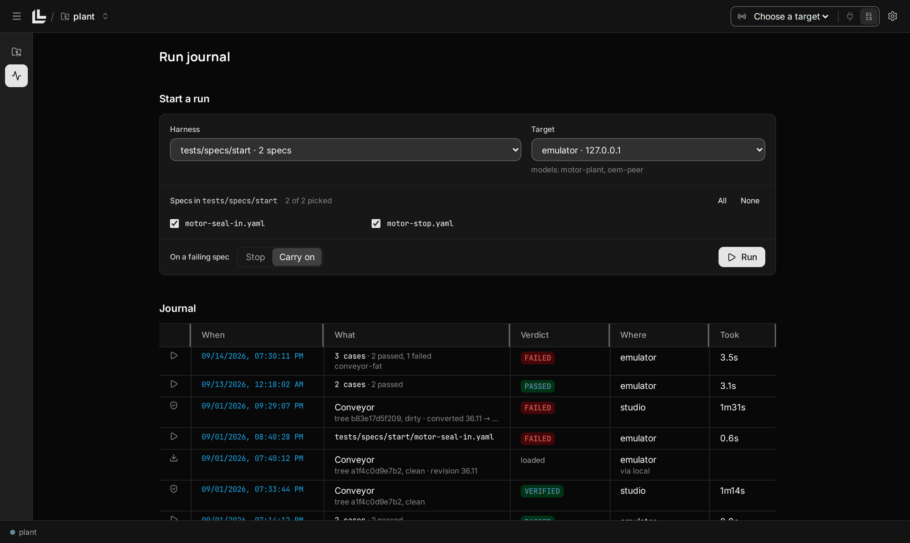

  

<h1 align="center">Logicly</h1>

  <strong>Your coding agent writes the logic. You see the ladder.</strong> 
  A workbench for AI-assisted PLC development with Studio 5000 projects.

  
  

  <a href="https://github.com/zanotra/logicly-releases/releases/latest"><strong>Download Logicly</strong></a> ·
  <a href="https://github.com/zanotra/logicly-releases/wiki">User guide</a> ·
  <a href="https://github.com/zanotra/logicly-releases/wiki/Examples">Try an example</a> ·
  <a href="https://github.com/zanotra/logicly-releases/issues">Feedback</a>

  

Bring a Logix project into your coding workflow. Logicly turns an L5X export into files your agent, editor or Python scripts can change. Review the ladder, check the changes and export back to Studio 5000.

## See the logic. Review the change.

### Review live ladder

Ladder updates as your agent saves. Compare Git changes, watch live tags and leave a pinned note for your agent.

  

### Find mistakes early

See syntax, tag-reference and instruction errors beside the affected rung. Validation errors block exports, downloads and test runs.

  

### Test the behavior

Run repeatable tests against Logix Echo or a controller. Add Python plant models on an emulator and review recorded results.

  

## Start with a project

Use the desktop app or your browser, with command-line tools for your agent and scripts.
L5X editing and validation need no Studio installation or connected controller.
Studio and Echo operations use a Windows engine with the corresponding Rockwell software.

**[Download for macOS, Windows or Linux](https://github.com/zanotra/logicly-releases/releases/latest)**

[Install Logicly](https://github.com/zanotra/logicly-releases/wiki/Install-and-update) · [Open your first project](https://github.com/zanotra/logicly-releases/wiki/First-project) · [Work with your agent](https://github.com/zanotra/logicly-releases/wiki/AI-agent)

The [wiki](https://github.com/zanotra/logicly-releases/wiki) has the walkthroughs, downloadable examples and full command, test-spec and Python references.

## Help and feedback

[Get help](SUPPORT.md) · [Report a bug or request a feature](https://github.com/zanotra/logicly-releases/issues/new/choose) · [Contribute](CONTRIBUTING.md)

For vulnerabilities, follow the [security policy](SECURITY.md) and report privately.

---

[FSL-1.1-ALv2](LICENSE). Each release becomes available under Apache 2.0 after two years.

Logicly is an independent project, not affiliated with or endorsed by Rockwell Automation.
Studio 5000 and FactoryTalk Logix Echo are trademarks of Rockwell Automation, Inc.
